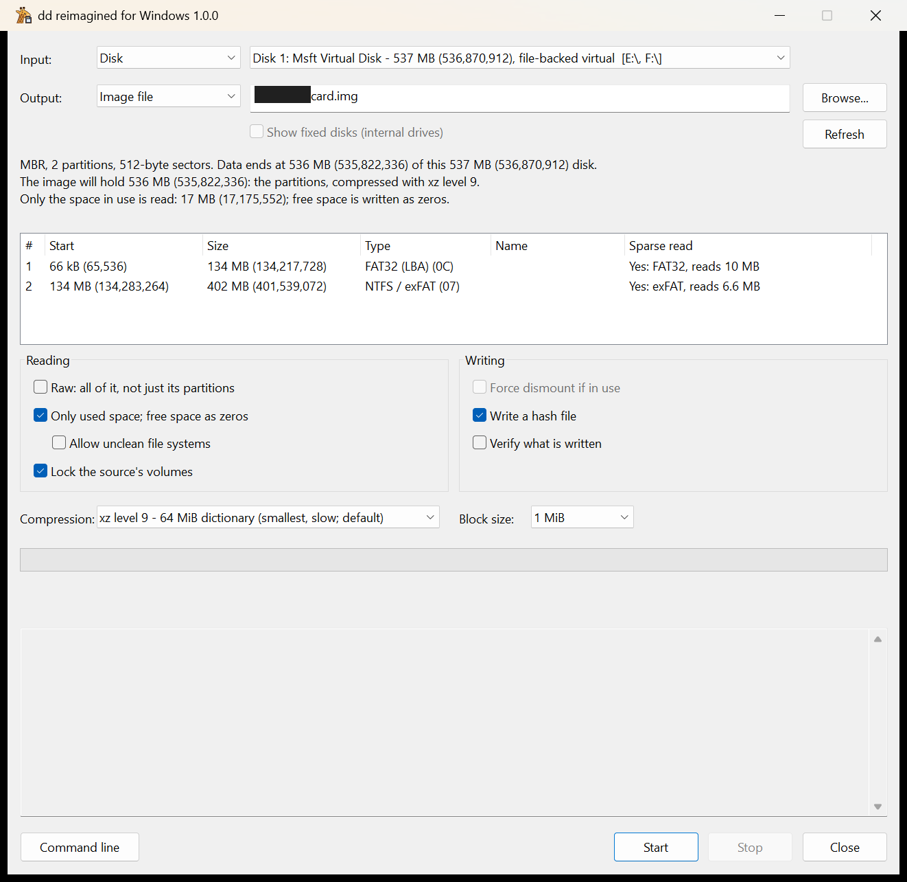
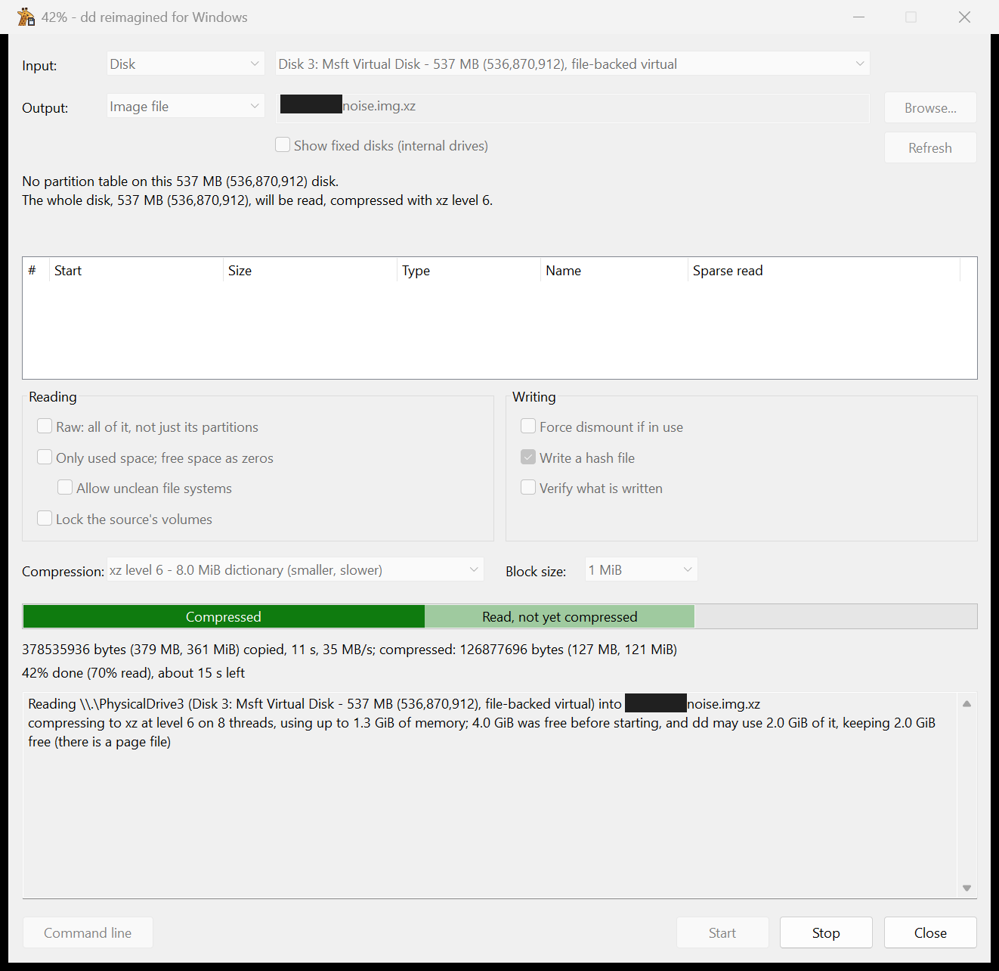
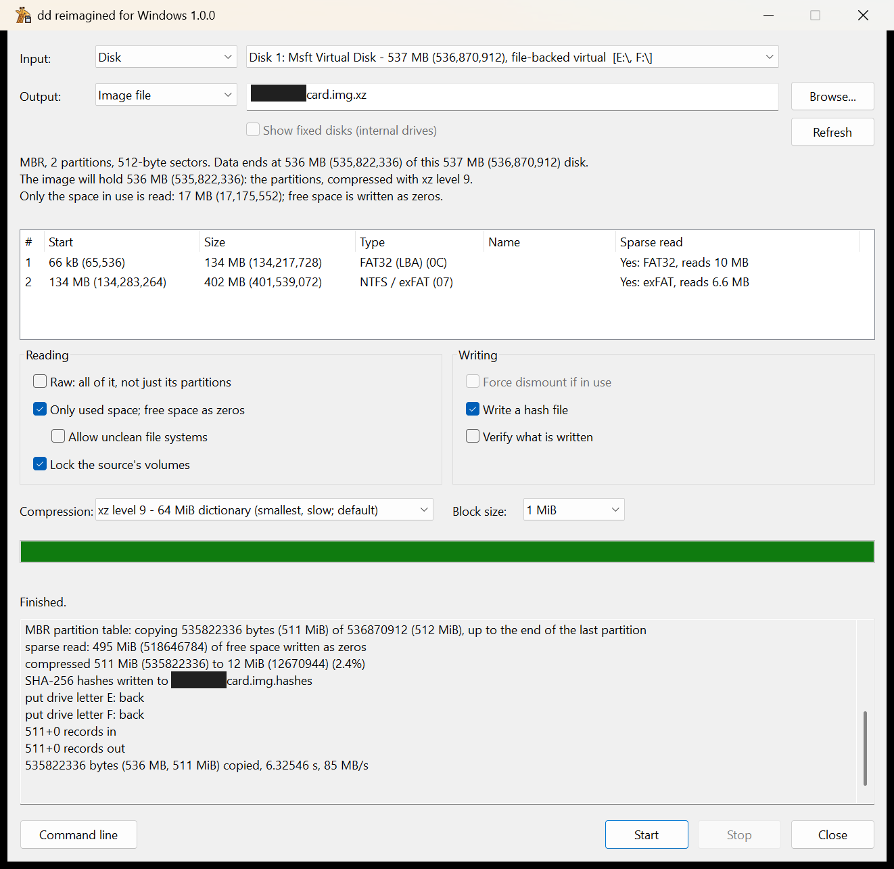
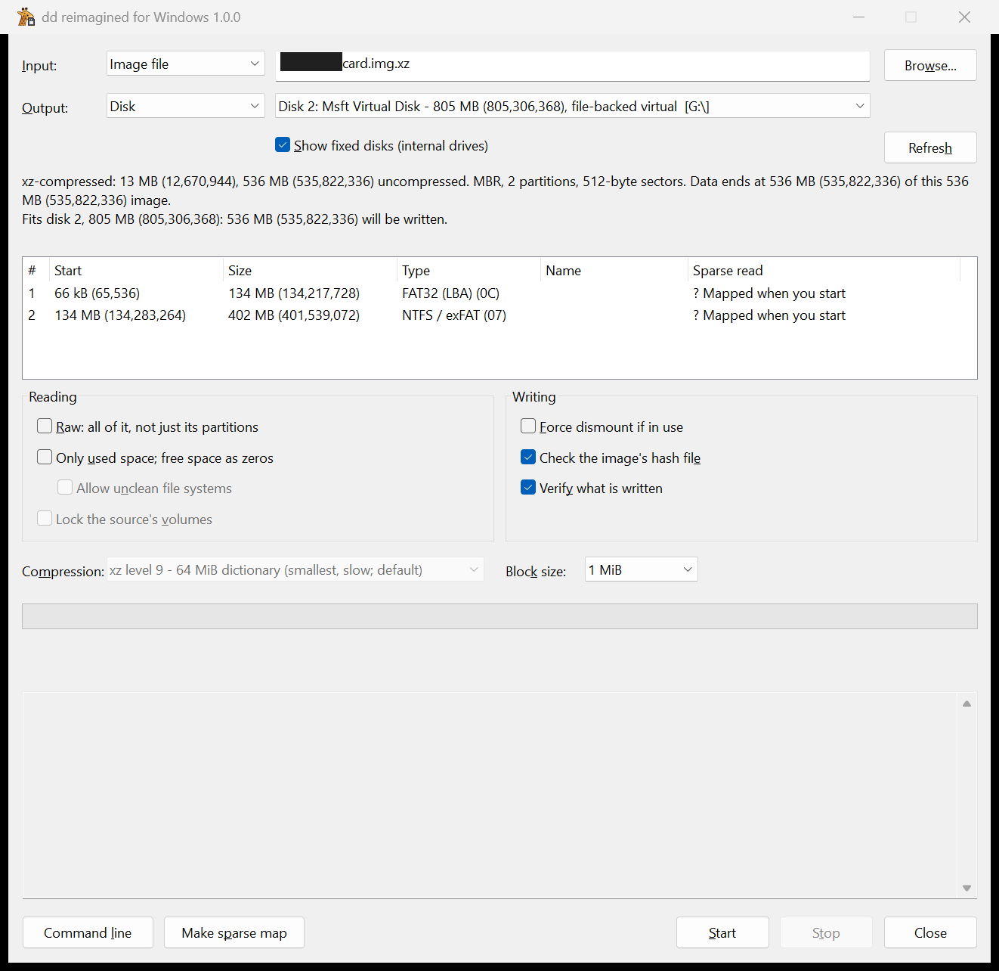
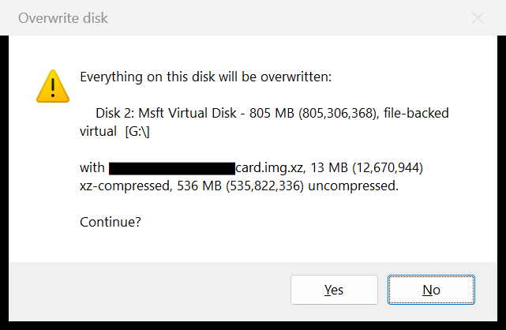
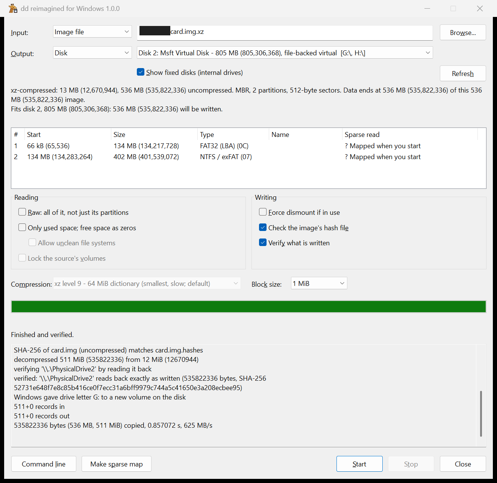
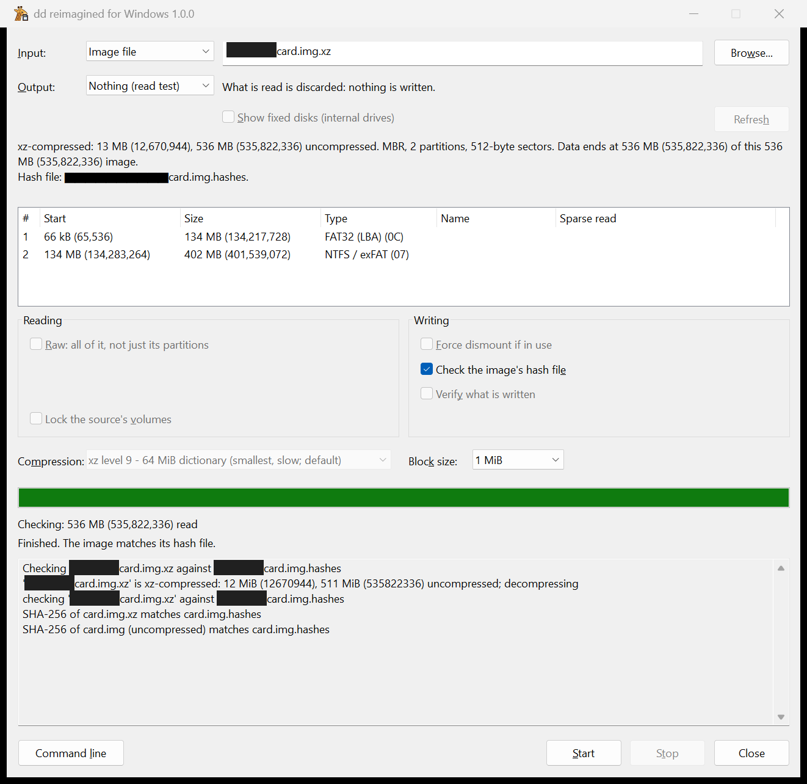
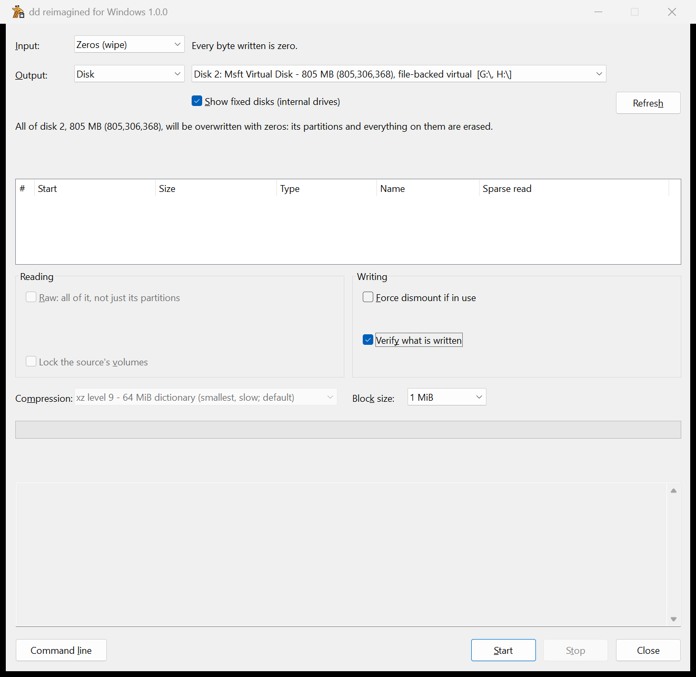
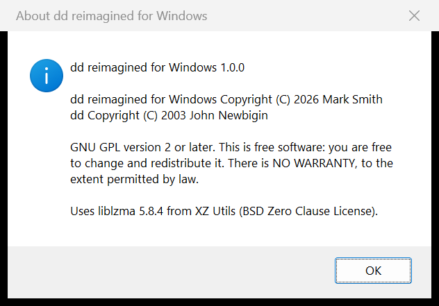

# dd-gui.exe

The graphical front end runs dd.exe's copy engine, so
[disks-and-safety.md](disks-and-safety.md) and [images.md](images.md)
apply to it too. It asks for administrator rights (for raw disk access)
and opens reading a disk into an image file, which changes no disk.

## The window

- **Input:** what is read.
  - *Disk*: a disk or optical drive.
  - *Image file*: plain or .xz; pick it with *Browse* or drop it on the
    window.
  - *Zeros (wipe)*, *Random data (wipe)*: zeros or system random data
    (`/dev/zero`, `/dev/random`), as much as the output disk holds. The
    output is then always a disk.
- **Output:** where it goes.
  - *Disk*: only removable disks (USB, SD, MMC) unless *Show fixed disks*
    is ticked. The disk Windows runs from is never offered.
  - *Image file*: the new file, picked with *Browse*.
  - *Nothing (read test)*: what is read is discarded (`/dev/null`).

| Input | Output | What it does |
|---|---|---|
| Disk | Image file | Reads a disk into an image (the default) |
| Image file | Disk | Writes an image to a disk |
| Image file | Image file | Re-packs an image: changes its compression, trims it to its partitions (unless *Raw*), zeroes free space (with *Only used space*). .xz to .xz works directly |
| Disk | Disk | Copies a disk, but never onto itself |
| Image file | Nothing | Checks the image against its hash file (`--verify-hashes`) |
| Disk | Nothing | Read test |
| Zeros or Random data | Disk | Wipes every byte of the disk |

Writing a disk always asks for confirmation. Disk lists refresh when a
device is plugged in or removed, or on *Refresh*.

File names must be full paths (`D:\Images\card.img`): a bare name goes to
the current folder, System32 when running as administrator.

- **Partition table:** the source's MBR (logical partitions included) or
  GPT, where its data ends and whether it fits the selected disk (an .xz
  image's start is decompressed for this).
- **Sparse read column:** per partition, how much sparse reading would
  read (`Yes: FAT32, reads 1.2 GB`) or why it can't
  (`No: ext4, not cleanly unmounted`).
- **Summary:** what will be read and written and whether it fits; for a
  wipe, the disk and how much is overwritten.

## Options

Reading:

- *Raw: all of it, not just its partitions*, unticked by default, so only
  the partitions are copied (`--fit`): an image of a 64 GB card with
  32 GB of partitions fits a 32 GB card. A disk the partitions don't fit
  is refused.
- *Only used space; free space as zeros* (`--sparse-read`), unticked by
  default; the summary says how much will be read. Ticking it offers
  *Allow unclean file systems* (`--allow-unclean`).
- *Lock the source's volumes* (`--lock-input`), for disk input, unticked
  by default. A FAT card Windows has just written to may show as not
  clean; locking makes Windows write its changes first, so it can be read
  sparsely.

Writing:

- *Force dismount if in use* (`--force-dismount`), for disk output.
- The hash file box, ticked by default, shown when an image file is
  involved: *Write a hash file* (disk to image), *Check the image's hash
  file* (image to disk or nothing; both hashes of a compressed image), or
  *Check and write hash files* (image to image).
- *Verify what is written* (`--verify`), unticked by default: reads the
  output back and compares it.

Both:

- **Compression:** *None* or .xz level 0 to 9, with each level's
  dictionary size shown. Level 9, the default, is smallest but slow
  (about 7 MB/s on 8 threads); level 3 is about 15 times faster and about
  20% larger. `.xz` is added to the file name. .xz input is recognised
  from its contents.
- **Block size:** how much is read and written at a time (default 1 MiB).
- **Make sparse map:** for image file input, enabled while a compressed
  image has no usable map. It maps the file systems now, for the *Sparse
  read* column and summary; *Start* makes the map anyway when needed.

Drive letters of locked volumes are removed during the copy and put back
afterwards, as dd.exe does by default (see
[disks-and-safety.md](disks-and-safety.md#drive-letters)).

## Reading a disk into an image

1. Choose *Disk* and the disk as input, *Image file* and the file as
   output.
2. Tick *Only used space* for a quick image of a mostly empty card,
   *Lock the source's volumes* so nothing changes it meanwhile, and pick
   a compression level.
3. Press *Start*. A progress bar, GNU-style transfer line (with the .xz
   size so far) and time left are shown; *Stop* ends the copy.

   xz buffers a large block per thread, so reading can run gigabytes
   ahead: the bar is solid for what is compressed, pale for what is only
   read (`40% done (75% read)`).

The image gets a hash file beside it (`card.img.hashes` for
`card.img.xz`) for checking later.

## Writing an image to a disk

1. Choose *Image file* and the file as input, *Disk* and the disk as
   output (tick *Show fixed disks* for a non-removable disk). The
   partition table and summary say, with exact sizes, whether the
   image's partitions fit.

2. Press *Start*. The confirmation names the disk, its size and drive
   letters, and warns if the image is bigger than the disk.

3. The disk's volumes are locked and dismounted until the copy (and
   verify) is done; if the image replaced them, Windows mounts the new
   ones.

If a disk is plugged in, removed or swapped while the confirmation is
open, the write is not started; check the disks and press *Start* again.

## Checking an image

*Image file* to *Nothing* compares the image with its hash file (for a
compressed image, both the image's and the .xz file's hashes). The summary
names the hash file, or says there is none.

Unticking *Check the image's hash file* just reads it, like
`dd if=card.img.xz of=/dev/null`; an .xz image's own checksums are still
checked.

## Testing a disk

*Disk* to *Nothing* checks that a card reads, and how fast, before
imaging it. Unless *Raw* is ticked it stops at the end of the partitions;
with *Only used space* it reads only used space. A read error ends it with
*Failed* and the error in the log.

## Wiping a disk

*Zeros (wipe)* or *Random data (wipe)* as input, with a disk as output,
overwrites every byte, like
`dd if=/dev/zero of=\\.\PhysicalDriveN bs=1M count=SIZE iflag=count_bytes`
with SIZE the disk's exact size. Confirmation, locking and drive letters
work as when writing an image.

*Zeros* is faster and reads back as empty; *Random data* leaves nothing
to tell written space from unwritten. *Verify what is written* works for
both.

Flash media (cards, USB sticks, SSDs) keep spare blocks the host cannot
reach, so overwriting does not guarantee erasing everything they held.

## Other conveniences

- **Command line** logs the equivalent `dd.exe` command, built by the
  same code as *Start*, e.g.
  `dd if=\\.\PhysicalDrive2 of=card.img.xz bs=1M --fit --filter=file --hashes --progress --xz=9`.
  The `\\.\PhysicalDriveN` name holds only until disks are plugged in or
  removed.
- **Drag and drop:** a dropped image file becomes the input; when reading
  a disk into an image, it switches to writing the image to a disk.
- **Idle priority:** dd-gui.exe uses only CPU time nothing else wants.
- **Version:** in the title bar (`dd reimagined for Windows 1.0.0`).
  *About dd reimagined for Windows*, in the window menu (the icon at top
  left, or Alt+Space), gives the version, copyright and licences.

